# One checkout address can expose far more than one sale

Imagine Mei runs a small online shop accepting Bitcoin SV (BSV). She gives every customer a new payment address. She keeps her recovery words safe. She expects each customer to see only their own payment.

Mei uses ElectrumSVP normally. To find her payments, the wallet asks a remote service about a group of payment addresses. It sends stable fingerprints of their payment instructions, including some prepared for future use. The service can save those fingerprints together as one profile.

Now imagine that service's operator opens Mei's checkout as a prospective customer. The checkout reveals one address. The operator computes its fingerprint and finds it in the saved profile. **One checkout address can give the operator a shop name for a much larger collection of financial activity.** It does not need to buy anything.

Payments to other addresses in that collection can now be associated with Mei's shop—even when every customer gets a different address. If the operator also observes customers' wallets, it can connect their payments to the shop. It can keep watching matching activity on the public blockchain after Mei changes servers and never comes back.

**Normal online use supplies the information for this kind of lasting financial surveillance. No separate privacy opt-in is needed for the default payment checks examined here.**

Mei is fictional. This explainer describes what a covert operator could collect, not evidence that a particular public service has done so. The research examined ElectrumSVP 0.2.0 and controlled wallet sessions on October 28–29, 2026. [What was tested](#what-we-demonstrated).

## How one address opens a wider view

An address is where a customer sends a payment. Its fingerprint is a stable identifier the service can match to blockchain records. The wallet sends several fingerprints through the same connection, so the service learns that they are being checked together.

The service does not need to recover every unused address from its fingerprint. As matching payments appear, their public records reveal the payment details. The checkout address provides the outside clue that associates the saved group with a shop.

This is why fresh addresses alone do not hide the collection from the service checking them. A regular customer may know one address; the serving operator has the additional record of which fingerprints the wallet checked together.

**Evidence:** [the shop scenario and its conditions](PERSISTENT-CORRELATION.md#one-checkout-address-can-identify-much-more-than-one-sale), [the single simulated checkout address](evidence/correlation-attempt-01/checkout.json), and [the valid-chain shop profile](evidence/valid-chain-attempt-05/result.json).

## Leaving does not take back the record

Suppose Mei stops using that service. The operator can keep its saved list and compare it with the public blockchain. It can recognize later payments to disclosed addresses, first payments to previously unused disclosed addresses, and spends of coins it already knows about.

**The old service needs no new connection from Mei.** Closing the app, asking it to stop notifications, changing an IP address or choosing a different server does not erase a copy already kept.

There is a boundary: the disclosed collection is finite. Completely undisclosed addresses or a separate wallet need another link. A spend of known coins is visible, but an unfamiliar destination is not automatically proven to be Mei's new change address. That boundary does not expire the identifiers already disclosed.

**Evidence:** [continued monitoring and its limits](PERSISTENT-CORRELATION.md#leaving-a-server-does-not-revoke-the-disclosed-collection), [a modeled later match after the wallet exited](evidence/fixture-attempt-04/future-watch.json), and [the later valid-chain departure experiment](VALID-CHAIN.md).

## The operator can connect customers to the shop

If customers use services that observe their wallets, the operator can have profiles on both sides of a payment. It can recognize a payment spending coins associated with one profile and reaching an address in the shop's profile. This reveals a relationship and the amount flowing along it.

The names in such a picture may initially be unknown. A checkout address can name the shop-associated profile. Other information would be needed to name a customer. Even unnamed wallet profiles can reveal repeated business relationships.

The controlled example below uses **fictional test amounts with no monetary value**. A “test sat” is a unit in the manufactured example.

Three different shop receive addresses were each paid once. The observer still reconstructed **7.75 million test sats received**. It linked 6.5 million to the two observed payer profiles. The third payer remained unidentified. Gross receipts alone do not establish sales revenue, profit or ownership of every payment.

**Evidence:** [the payment-graph analysis](PERSISTENT-CORRELATION.md#the-multi-user-payment-graph), [the reconstructed amounts and links](evidence/correlation-attempt-01/correlation.json), and [the independent checks](evidence/correlation-disclosure-verification.json).

## What ordinary use reveals

| Recipient | What it can learn from the reviewed requests |
| --- | --- |
| Main wallet service | The group of payment fingerprints, related payment history, requested transactions and submitted payments. It also ordinarily sees the connecting IP address, or a proxy's exit address. |
| Separate built-in helper services | Copies of individual checks sent to them. A startup block-height check does not reveal a wallet balance; a later transaction lookup can reveal a specific financial interest. Some later checks happen automatically. |
| Price and update services | App-use and connection information from generic requests. The reviewed calls do not contain wallet balances or payment identifiers. |
| Network and DNS providers | Connection destinations, timing and related name queries as their role permits. Passive observation of encrypted traffic does not automatically reveal the financial requests inside it. |

The main service's record can be linked through a connection even without knowing the user's name. An IP address alone is not proof of one person's identity. Shared wallets, watched addresses and shared internet connections also affect attribution.

Different server names do not establish separate privacy boundaries. Several names in the tested release share infrastructure. For cautious privacy planning, this research assumes those related services can pool their observations, and also considers sharing across providers. Common ownership and actual sharing remain unproved. [Recipient counts, shared infrastructure and the full visibility table](TRUST-MODEL.md).

## Your keys can stay private while your finances are observed

The ordinary requests examined did not send recovery words or private keys. Those protect the ability to spend. The questions sent to a remote service can still expose payment history and relationships.

Transport encryption can hide requests from passive observers along the route; the receiving service processes the questions. The examined Electrum connections also failed to check the server's identity properly, allowing an attacker who can redirect or intercept the connection to impersonate it. A correctly routed privacy proxy can hide the original connecting IP, but the service still receives the payment fingerprints. The separate helper has its own routing decision: choosing a main server or setting a main proxy does not by itself control every path. [Routing and protection limits](TRUST-MODEL.md#who-can-see-which-data).

The reviewed project does offer some technical Network help about sending payment metadata for history. It does not explain the full lasting-surveillance and shop-correlation consequences in the consumer material we reviewed. Its broad proxy-help assurance also conflicts with the helper's separate routing. Public technical discussions acknowledge related server-security risks. **We did not measure what ordinary users understood.** [Disclosure evidence and its limits](DISCLOSURE-AUDIT.md).

## What we demonstrated

The official macOS wallet opened a fresh, empty standard account with network settings left unset. It completed **40 identifier subscriptions** to its main service. Seven core services and seven helper destinations were observed, with different roles: only the main received the full collection; helper sends in that empty session carried a block height. Screenshots show automatic selection on and proxy use off. [Desktop capture and controls](PACKAGED-WALLET.md).

We then reproduced the shop story on a **valid, isolated Bitcoin SV test chain**, using three actual wallet cores and a documented research serving adapter. Two buyers signed payments to different fresh shop addresses; an unknown payer paid a third. One checkout address identified the saved shop collection. After the shop moved both its main and helper routes to a new observer, the old observer received **no new client request**. It still recognized a later receipt and spend from its saved list and public test-chain records. It reconstructed **9,450,000 test satoshis received and 8,349,000 remaining**, agreeing with the wallet. [Experiment, raw evidence and limits](VALID-CHAIN.md).

A second node started from an empty data directory and accepted all retained blocks. The amounts had no monetary value, no real shop/customer was investigated, and no production server was attacked. ElectrumR's documented source remained unavailable; the research adapter is clearly distinguished from it. The payment diagram above shows the earlier 7,750,000-satoshi receipt example; the new test adds the later 1,700,000-satoshi receipt after departure. Earlier synthetic records remain available as separate exercises. The collection is finite, and queried interests do not prove legal ownership.

The [certificate experiment](CERTIFICATES.md) also showed both source and packaged runtimes accepting wrong-host, self-signed and expired certificates. The verified control rejected them. That matters for an attacker able to redirect a connection; passive observation alone does not decrypt TLS. The desktop [proxy help](evidence/packaged-gui-attempt-01/proxy-assurance.png) claims every connection is covered, while the [controlled routing test](MITIGATIONS.md) demonstrates the helper's separate route. No participant study of reader understanding has been conducted.

## The trust you are placing in the service

Your financial privacy depends on the operator choosing **not to keep a lasting financial profile, identify it through outside clues, connect it to other users, share it, or keep watching it after you leave**. A promise about today's logging defaults does not remove those capabilities.

Before using the wallet, a person needs clear answers about who receives the payment identifiers, which settings cover every connection, what can remain observable afterward, and which server names may share observations. This explainer documents that trust burden. The [research report](REPORT.md), [version-specific server counts](DISCLOSURE-AUDIT.md#version-specific-destination-counts), [raw records](evidence/correlation-attempt-01/) and [reproduction instructions](REPRODUCE.md) provide the evidence behind it.
