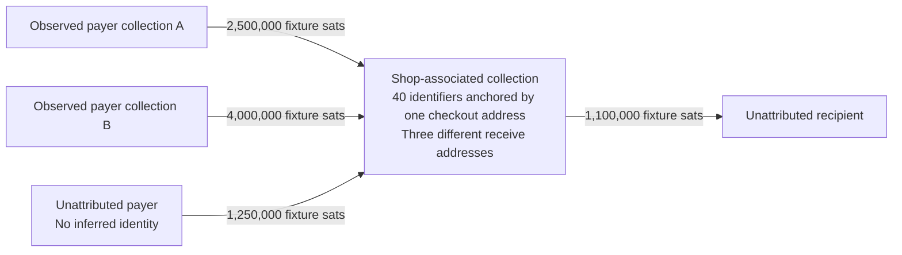

# A session can become a lasting financial profile

October 29 update: [official desktop capture](PACKAGED-WALLET.md), [valid-chain shop/departure proof](VALID-CHAIN.md), [certificate tests](CERTIFICATES.md) and [claim ledger](CLAIMS.md) now supplement the earlier evidence below. Earlier synthetic cases remain explicitly separate.

For ordinary readers, [the shopkeeper explainer](EXPLAINER.md) walks through this mechanism with simple diagrams.

**The original report contemplated continued watching, but did not fully develop cross-user correlation or the one-address shop scenario. This extension does.** The default online subscription behavior supplies the raw material without a separate privacy opt-in. Under this report's covert-operator model, the serving party acts as a **financial surveillance infrastructure operator**: it can build durable financial profiles and a payment graph between observed collections. This names the modeled function and capability, not an allegation that a particular public operator has been observed performing it.

The [consumer sharing model](TRUST-MODEL.md) treats the six release-listed services in the shared IPv4 segment as related and pooling observations, and also considers pooling across all providers. The following correlations therefore need not happen inside just one named server or one original connection.

## Leaving a server does not revoke the disclosed collection

A retained script identifier is a durable join key to a public ledger. The operator can keep matching new outputs to it and detecting spends of matching old outputs. It needs neither another connection from that wallet nor a continuing subscription on the old server. A server-side indexer already watches the ledger; adding a retained watchlist does not require reversing a hash or compromising keys. Unsubscribing asks to stop protocol notifications; it cannot revoke a saved identifier or prevent independent ledger monitoring.

This supports more than watching for another payment to a reused address:

- **Previously funded identifiers:** new payments to those scripts and spends of their known outpoints remain detectable.
- **Unused lookahead identifiers already disclosed:** a first payment to one can resolve it to an address after the wallet has left. Address non-reuse does not undo its earlier disclosure.
- **Transactions spending observed coins:** their destinations, output values and timing become public regardless of which service broadcasts them. Outputs returning to the retained collection are directly recognizable as associated change.
- **Historical records:** an identity learned later can label the retained collection and its earlier recorded transactions, as well as later matches. Prior IP changes or a later switch to Tor do not erase that join.

For a known identifier, the ledger match is deterministic. **Attribution to a legal person is a separate inference.** A connection establishes queried interests; a shop checkout can establish a business-associated anchor. Watch-only collections, shared wallets, shared IPs and delegated business administration can complicate who controls or owns the funds.

“All subsequent activity by the person” would be too broad without a continuing link. The retained collection is finite. It does not reveal an xpub or the unlimited HD tree. A completely undisclosed new script or independent wallet does not become identifiable solely because the operator once saw another collection. A spend from an observed coin remains visible, but an output outside all known collections is not automatically proven to be that user's new change. Heuristics or another source could extend attribution; those links must be identified separately.

These boundaries do not make leaving a server an effective revocation mechanism: **the already disclosed collection remains observable indefinitely while the public records remain available**. Observing public transactions does not require the old API endpoint to stay online. The default spent-key deactivation setting and normal lookahead expansion can disclose an extensive collection while the wallet is in use.

## The multi-user payment graph

Suppose the operator has separately retained collections A and B. A transaction spends an outpoint associated with A and pays an output whose script identifier is in B. The operator can join those records and record a directed value flow, its time and its public transaction ID. Different receiving addresses do not prevent that join when the server already received each collection through its sessions.

With suitable identity anchors, the graph can associate buyers, merchants, suppliers, customers and repeated relationships. Amount totals and transaction cadence may support business-sensitive inferences. **Gross observed receipts are not automatically revenue, profit, salary or taxable income.** Transfers, refunds, shared ownership, missing addresses and incomplete history can change the interpretation. A graph of observed interests is still powerful even when some nodes lack real-world names.

A single transaction may have multiple input owners. When that is unresolved, the operator can see value reaching B but cannot honestly assign every output to one identified payer. Our analyzer explicitly preserves that ambiguity. If only the merchant is observed, its incoming amounts can still be measured for known scripts, while an unobserved customer's identity remains unknown.

## One checkout address can identify much more than one sale

The shop uses a fresh receive address for every order. Its wallet nevertheless asks its serving operator about a collection of receiving and change identifiers over one connection. The covert operator visits the checkout as an ordinary prospective customer and obtains **one** address. It can:

1. Convert that public address to its locking script and compute the protocol's script identifier.
2. Match that identifier to a retained wallet-session collection, even before the operator pays or the address receives anything.
3. Label the matching collection as associated with that shop. This includes its other disclosed receiving identifiers and change identifiers, not only the checkout address.
4. Aggregate payments to those other identifiers, including receipts from different customers using different addresses, both retrospectively and prospectively.
5. Where payer collections are also observed, link their payments to the shop-associated collection. Where payer collections are unknown, retain unnamed counterparties rather than invent identities.
6. Continue this work from public ledger data after the shop changes servers or stops using this wallet.

**Address non-reuse does not defend against a service that has already been given the address collection's membership.** This attack does not depend on the usual public-chain common-input or change heuristics to create that initial collection. It uses the wallet's own query grouping and one outside business anchor.

Conditions matter: the checkout address must match a disclosed identifier, and retained records must permit the join. An externally generated checkout address beyond the wallet's disclosed range may not initially match. A matching session is evidence of interest in the shop's funds, not proof that every script is legally owned by one shopkeeper. A merchant may operate accounts for multiple businesses or watch outside addresses. These are attribution questions, not erasure of the revealed association.

No real shop was visited for this study. The prospective-customer interaction below is a simulated public anchor for a fictional controlled shop.

## Controlled demonstration after all clients exit

Three fresh BIP39 accounts ran through the unchanged upstream `Wallet`, `StandardAccount` and `Network` using ordinary **20 receiving + 20 change** discovery. Each disclosed **40 distinct identifiers** to a recording loopback TLS endpoint. The 120 identifiers were disjoint. They synchronized empty histories and then exited. The analyzer sees only the retained protocol capture, a later raw-transaction fixture and one checkout address; it receives no seed, wallet database, derivation paths or scenario ground truth.

After all three clients exited, the harness constructed a **manufactured unsigned ledger with fictional funding parents**. It is not consensus-valid real-chain funding, an ElectrumR deployment or a wallet-signing demonstration. Its amounts have no monetary value. The earlier [financial fixture](REPORT.md#controlled-financial-reconstruction) separately exercised real wallet signing; this follow-up tests the correlation logic and its limits.

| What the retained interests and later ledger reconstruct | Fixture result |
| --- | ---: |
| Checkout addresses supplied to analyzer | **1** |
| Shop-associated identifiers anchored by it | **40** |
| Distinct shop receive addresses paid, each once | **3** |
| Observed payer collection A → shop | 2,500,000 sats |
| Observed payer collection B → shop | 4,000,000 sats |
| Unattributed payer → shop | 1,250,000 sats |
| Shop gross observed receipts | **7,750,000 sats** |
| Shop → unattributed external recipient | 1,100,000 sats |
| Shop remaining observed outputs | 6,649,000 sats |
| Wallet clients required to return to the original service | **0** |

The checkout was `1PtXCMseMGrVipuNvkohhfwaguS5yvvF9t`, associated with captured session 6. The other two collections were sessions 2 and 4. All peer addresses were loopback: the association depends on separate connections and script sets, not invented residential IPs. Three separately generated controlled accounts establish scenario ground truth, while the reconstruction continues to describe them as observed collections.

A negative-control transaction to an unlinked script remained unlinked. A second check mixed inputs from two observed collections; the analyzer refused to label that payment as originating from one identified payer. An empty-ledger check still anchored the shop's 40 identifiers from the single checkout address, demonstrating that making a payment is not required to establish the collection association.

Controls include loopback routing, one-server mode, auto-connect disabled, headless callbacks, isolated paths and blocked non-loopback socket connections. These constrain the experiment's destinations; they preserve the default subscription grouping being tested. No real funds or third-party wallet data were used. Disposable seeds, wallet files and TLS keys were removed.

See [the capture](evidence/correlation-attempt-01/capture.jsonl), [the single-address anchor](evidence/correlation-attempt-01/checkout.json), [later ledger](evidence/correlation-attempt-01/later-ledger.json), [reconstruction](evidence/correlation-attempt-01/correlation.json), [run controls](evidence/correlation-attempt-01/run.json) and [offline verification](evidence/correlation-disclosure-verification.json).

## What users must trust the infrastructure not to do

The relevant trust is not just whether an operator logs a connection today. It includes discretion **not to retain wallet-interest collections, attach outside identity anchors, build cross-user value-flow graphs, pool them with other providers, sell or disclose the results, or keep watching after disconnection**. The APIs make these capabilities available without adding spyware to the wallet or breaking transaction cryptography. SPV and BREAD can help assess ledger evidence without concealing which evidence the user asks a remote operator to retrieve.

The [disclosure audit](DISCLOSURE-AUDIT.md) evaluates whether the reviewed project surfaces explain this burden. [The stories](PRIVACY-STORIES.md) translate it into everyday expectations.
