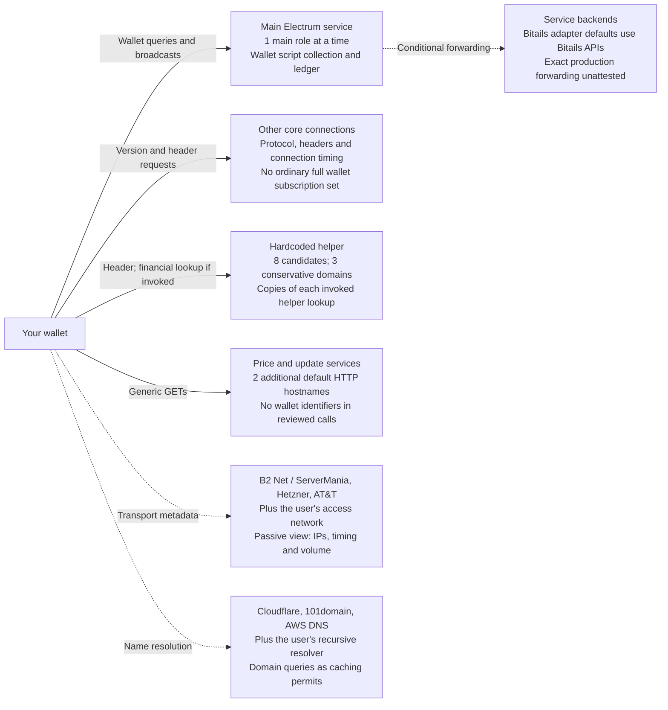

# Operator-visible wallet dossier and the end-user trust model

Research date: 2026-10-28, America/Los_Angeles. Scope: a covert serving operator retaining everything available at its API boundary while a user follows the wallet's ordinary synchronization behavior. No reliance is placed on server logging defaults or retention promises.

Start with [the plain-English shopkeeper explainer](EXPLAINER.md) for a guided account of default disclosure, cross-user payment links and lasting observation, with diagrams and evidence links.

## Source and deployment identification

The client is [TruthMachine/ElectrumSVP v0.2.0](https://github.com/TruthMachine/ElectrumSVP/releases/tag/v0.2.0), commit `672df8f4512f6adf16a3c99146baa6be9b93d86f`. Its source working tree remained unchanged. The runtime is CPython 3.10.20 on macOS arm64, BitcoinX 0.9 and aiorpcX 0.18.7. All resolved versions are in `requirements-wallet.lock.txt`. This is not an assertion that the published desktop binaries use exactly this environment.

The release's [priority server list](https://github.com/TruthMachine/ElectrumSVP/blob/672df8f4512f6adf16a3c99146baa6be9b93d86f/electrumsv/network.py#L1699-L1753) includes `sv.electrumr.sv:50002` and `sv2.electrumr.sv:50002`. Both answered ordinary public metadata RPCs and identified themselves as `ElectrumR 0.2.0`, protocol 1.4.2. The recorded endpoints resolved to `198.154.93.197` and `198.154.93.212`. DNS addresses and server identity strings are observations at the capture time, not permanent identifiers or attestations of the running binary. See [exact probes and certificate fingerprints](evidence/provenance-20261028/default-server-probes.json).

The [ElectrumR documentation](https://electrumr.io/docs.html) points to `https://github.com/KeyvanJS/ElectrumR` as the build source. That repository and its releases endpoint returned HTTP 404 through public retrieval and the operator's authenticated account. The publisher's public-repository list and scoped repository/code searches did not identify the advertised implementation. Direct Python retrieval initially returned HTTP 403; those errors remain retained. The follow-up fetched the official pages successfully with a regular browser-style user agent and again found the same GitHub source link. No access to the unavailable repository was obtained.

**No matching accessible public ElectrumR source or build artifact was found in this investigation.** A website advertising a source link and MIT licensing does not make unavailable source auditable. This prevents independent inspection of the actual server implementation, reproducible builds, code-to-deployment comparison, inspection of undisclosed collection/forwarding, and the requested self-hosted instrumented run. It is an additional accountability and provenance gap on top of the protocol privacy exposure.

These observations do not establish that the implementation is legally proprietary, that source never existed, or that an operator actually misuses requests. A 404 alone cannot determine whether a repository was made private, deleted, renamed or is otherwise inaccessible. The available evidence also cannot determine the latest unpublished build; 0.2.0 was advertised by the two explicitly ElectrumR-named bundled endpoints and two Satoshi-named endpoints on the research date. Public source was found for other server families, as detailed below; the unavailable-source conclusion is specifically about the advertised ElectrumR implementation.

The following release counts and runtime experiments are pinned to **0.2.0**. The newer public master observed during the disclosure audit, `35b92ec9` (October 11), changes the destination lists: eight core and eight helper hosts now coincide, with five shared-segment names. The reviewed consumer messaging is largely unchanged. See [the version comparison](DISCLOSURE-AUDIT.md#version-specific-destination-counts); do not mix its counts with the tested release.

## Hardcoded destinations and current network observations

The table below combines the eight literal core priority hosts in `network.py` with the eight literal verification-helper hosts in `verification_utils.py`: **nine unique hostnames**. The pool columns identify request paths; they do not imply every server received the complete wallet collection. A selected core main server receives core wallet subscriptions/history/broadcasts. A helper recipient receives copies of the individual helper RPCs that are invoked. Auxiliary core connections ordinarily receive protocol/header traffic rather than the entire subscription set.

Source locations: [core pool](https://github.com/TruthMachine/ElectrumSVP/blob/672df8f4512f6adf16a3c99146baa6be9b93d86f/electrumsv/network.py#L1699-L1753), [verification pool](https://github.com/TruthMachine/ElectrumSVP/blob/672df8f4512f6adf16a3c99146baa6be9b93d86f/electrumsv/verification_utils.py#L30-L44). Hostnames and ports are pinned source facts; the IP addresses and advertised software below are independent DNS/metadata observations collected on **2026-10-28 UTC**. All active literal entries use **TLS on port 50002**. We performed ordinary metadata RPCs only; no third-party wallet was queried.

| Hostname | Core priority pool | Verification helper | Port/transport | DNS addresses observed | Advertised server version |
| --- | --- | --- | --- | --- | --- |
| `bsv.aftrek.org` | Yes | Yes | `50002` / TLS | `128.140.53.204`, `2a01:4f8:c17:3e4c::1` | `ElectrumX 1.19.0` |
| `electrum.server.sv` | Yes | Yes | `50002` / TLS | `198.154.93.210` | `No successful identification; see raw error` |
| `electrumx.gorillapool.io` | Yes | Yes | `50002` / TLS | `99.127.49.102` | `ElectrumX 1.20.2` |
| `esv.bitails.io` | Yes | No | `50002` / TLS | `49.13.228.56` | `ElectrumX 1.20.2` |
| `sv.electrumr.sv` | Yes | Yes | `50002` / TLS | `198.154.93.197` | `ElectrumR 0.2.0` |
| `sv.satoshi.io` | Yes | Yes | `50002` / TLS | `198.154.93.195` | `ElectrumX 1.20.2` |
| `sv2.electrumr.sv` | Yes | Yes | `50002` / TLS | `198.154.93.212` | `ElectrumR 0.2.0` |
| `sv2.satoshi.io` | Yes | Yes | `50002` / TLS | `198.154.93.202` | `ElectrumR 0.2.0` |
| `sv3.satoshi.io` | No | Yes | `50002` / TLS | `198.154.93.200` | `ElectrumR 0.2.0` |

Raw [DNS answers, record types and TTLs](evidence/destinations-20261028/dns.json), [metadata RPC responses, connected peer addresses and certificate fingerprints](evidence/destinations-20261028/endpoint-metadata.json), and [literal source pools](evidence/destinations-20261028/source-destinations.json) are retained separately. DNS was not authenticated with DNSSEC. A DNS answer establishes a candidate address at the observation time; it does not establish a successful connection, long-term routing, operator identity, or ownership.

Four responding hostnames advertised **ElectrumR 0.2.0**: `sv.electrumr.sv`, `sv2.electrumr.sv`, `sv2.satoshi.io`, and `sv3.satoshi.io`. `electrum.server.sv` resolved but did not successfully identify itself during the bounded probe; that is not evidence it is permanently offline. Six of the nine names resolved to IPv4 addresses in `198.154.93.0/24`. This address grouping does not prove common ownership or independent operators. Different names, IPs and self-reported software versions do not attest different collection policies or independently controlled systems.

This is **not an exhaustive egress allowlist**. Cached/custom server objects and server-supplied peers with usable ports can expand the core pool. Main selection uses `random.choice` over eligible server objects, not a promise to choose the first listed hostname. In the retained live run, the main server also advertised these additional names:

| Advertised hostname | Server-advertised IP | Advertised transport flags | Acceptance in the tested client parser |
| --- | --- | --- | --- |
| `neptune.api.sv` | `195.144.22.198` | `s`, `t`, without numeric ports | Rejected |
| `electrum.api.sv` | `78.110.160.26` | `s`, `t`, without numeric ports | Rejected |

Those IPs are server-provided advertisements, not current DNS results or proof of connections. An [exact upstream parser check](evidence/destinations-20261028/peer-discovery-check.json) found that **all seven peers in that captured response were rejected**: bare `s`/`t` flags produced empty port strings rather than numeric ports in this client. The report does not silently supply default ports or claim those advertised servers received data in this run. Other peer responses containing explicit usable ports can still extend the pool. See [the parser](https://github.com/TruthMachine/ElectrumSVP/blob/672df8f4512f6adf16a3c99146baa6be9b93d86f/electrumsv/network.py#L1182-L1196).

There are also important differences between bundled configuration sources:

- `esv.bitails.io` is in the core priority pool but absent from the verification-helper pool.
- `sv3.satoshi.io` is in the helper pool but absent from the literal core priority pool.
- `electrum.api.sv`, `neptune.api.sv`, and `alpha-esv.api.sv` appear as **commented-out** entries in the examined pool code. Commented entries are not active literal defaults; advertisements or saved user state are separate paths.
- The fallback [mainnet `servers.json`](https://github.com/TruthMachine/ElectrumSVP/blob/672df8f4512f6adf16a3c99146baa6be9b93d86f/electrumsv/data/servers.json) literally contains `sv.electrumr.sv'` and `sv2.electrumr.sv'`, with trailing apostrophes. These must not be silently normalized in a provenance record. It lists TLS `s=50002` and, except for Bitails, optional plaintext `t=50001`, protocol label `1.4`, and pruning marker `-`. Import from that fallback is conditional on fewer than five known server objects after priority insertion; the eight valid priority entries ordinarily already exceed that threshold. Its presence does not prove the malformed hosts are contacted by a fresh default run.

## Relevant hardcoded default values

These are the reviewed release's fresh ordinary-desktop/mainnet values, rather than a dump of an existing user's configuration. Saved configuration, another network mode, an explicit server selection or a discovered peer can change destinations. The controlled experiments' endpoint pinning and one-server settings remain explicit deviations.

| Setting / source path | Default or literal value | Relevance |
| --- | --- | --- |
| `commands.add_network_options`: `server` | `None` | No user-pinned endpoint on a fresh configuration. |
| `Network._read_config` / `_random_server_nowait` | Random eligible server using protocol `s` | The selected main endpoint can vary. |
| `oneserver` / connection-loop target | `False` / **10** connection slots | This is a target, not proof ten distinct servers connected or all received address subscriptions. |
| `Network.auto_connect` | `True` | Main selection can move to another eligible endpoint after failure/lag. |
| `Network._read_config`: `proxy` | `None` | Ordinary desktop default connects directly. TAILS/helper Tor handling is separate. |
| Core pool fallback threshold | Fewer than **5** known server objects | Controls when bundled JSON entries are imported. |
| Startup main-server batch | `server.banner`, `server.donation_address`, `server.peers.subscribe` | The peer response can influence the known-server collection. |
| Client version / protocol range | `0.2.0` / `1.4` through `1.4.2` | Supplied in the version handshake. |
| Receiving / change lookahead | **20 / 20** | A fresh standard account initially monitors 40 scripts. |
| Enabled standard-account script type | `P2PKH` | Requests contain hashes of these output scripts. |
| Script identifier | Reversed hexadecimal `SHA256(locking_script)` | Matches the server's public-ledger index and future outputs. |
| `deactivate_used_keys` | `False` | Spent keys are not automatically removed from monitoring. |
| New-account seed / BIP39 passphrase | **12** words / empty string | Wallet-creation defaults; no generated seed is published in this research. |
| Mainnet BIP44 coin type / account 0 | **0** / `m/44'/0'/0'` | Source wizard default; receiving/change suffixes are local wallet structure. |
| Change / multiple-change settings | `True` / `True`; `max_change_outputs=10` | These affect which wallet-associated outputs may appear. |
| Fee-rate fallback | `DEFAULT_FEE=105` sats/kB | The experiment's fixed **1,000-sat total fee** is a scenario control, not this default rate. |
| Script subscription retry loop | **3** attempts, **2** seconds between temporary-failure retries | Repeated requests can expose the same identifiers again. |
| Per-server connect retry loop | Up to **6** attempts, **10**-second failure sleeps | Failed connectivity can lead to retries and later main-server changes. |
| Verification helper default pool / workers | `SERVERS` / `len(server_items)`; **8** peers here | Parallel copies may reach several operators. |
| Verification helper socket timeout | `TIMEOUT=5` seconds | Bounds each connect/read stage, not a deletion/retention window. |
| Helper Tor endpoint / detection probe | `127.0.0.1:9050` / **1** second | Helper independently selects SOCKS5 on TAILS or when a local Tor daemon responds. |
| Core connector TLS context | `ssl.SSLContext(ssl.PROTOCOL_TLS)` | In the tested Python 3.10 runtime: **`CERT_NONE`, `check_hostname=False`**. |
| Verification helper TLS context | `ssl._create_unverified_context()` | Certificate and hostname authentication are disabled on this path. |

The core constructor is visible [here](https://github.com/TruthMachine/ElectrumSVP/blob/672df8f4512f6adf16a3c99146baa6be9b93d86f/electrumsv/network.py#L296-L307); the helper context and independent Tor choice are visible [here](https://github.com/TruthMachine/ElectrumSVP/blob/672df8f4512f6adf16a3c99146baa6be9b93d86f/electrumsv/verification_utils.py#L335-L410). We separately evaluated the core constructor's verification flags in the recorded research runtime. The presence of `certifi` imports or bundled PEM files does not establish that this connector enables verification. This is a source/runtime observation, not a staged MITM or a packaged-binary audit. TLS encryption on these paths should not be described as proof of an authenticated operator identity.

Further source anchors: [CLI defaults](https://github.com/TruthMachine/ElectrumSVP/blob/672df8f4512f6adf16a3c99146baa6be9b93d86f/electrumsv/commands.py#L294-L301), [connection slots](https://github.com/TruthMachine/ElectrumSVP/blob/672df8f4512f6adf16a3c99146baa6be9b93d86f/electrumsv/network.py#L1573-L1587), [automatic switching](https://github.com/TruthMachine/ElectrumSVP/blob/672df8f4512f6adf16a3c99146baa6be9b93d86f/electrumsv/network.py#L2007-L2008), [subscription retries](https://github.com/TruthMachine/ElectrumSVP/blob/672df8f4512f6adf16a3c99146baa6be9b93d86f/electrumsv/network.py#L1096-L1117), [account discovery](https://github.com/TruthMachine/ElectrumSVP/blob/672df8f4512f6adf16a3c99146baa6be9b93d86f/electrumsv/wallet.py#L2208-L2221), [standard scripts](https://github.com/TruthMachine/ElectrumSVP/blob/672df8f4512f6adf16a3c99146baa6be9b93d86f/electrumsv/wallet.py#L2261-L2272), [account creation](https://github.com/TruthMachine/ElectrumSVP/blob/672df8f4512f6adf16a3c99146baa6be9b93d86f/electrumsv/gui/qt/account_wizard.py#L427-L447), [mainnet derivation](https://github.com/TruthMachine/ElectrumSVP/blob/672df8f4512f6adf16a3c99146baa6be9b93d86f/electrumsv/networks.py#L74-L87), [change policy](https://github.com/TruthMachine/ElectrumSVP/blob/672df8f4512f6adf16a3c99146baa6be9b93d86f/electrumsv/wallet.py#L1455-L1474), and [fee fallback](https://github.com/TruthMachine/ElectrumSVP/blob/672df8f4512f6adf16a3c99146baa6be9b93d86f/electrumsv/simple_config.py#L276-L282).

## Counted trust relationships and consumer sharing model

**Major centralization risk:** six of the nine literal Electrum destinations share **198.154.93.0/24**. That is **66.7% of the union**, **62.5% (5/8) of core entries**, and **75% (6/8) of helper entries**. These are inventory proportions, not traffic shares, selection probabilities or proof of physical co-location.

At the user's request, this report's **consumer threat model assumes those six endpoints are related and pool all observations**, unless their separation can be verified. It also evaluates sharing across every service provider. Different names or brands are not assumed to enforce privacy separation. This is a conservative risk assumption; the preceding and following public records do not prove common legal ownership, common administration or actual sharing. Lack of disproof alone is not ownership evidence. Sharing combines the data each service receives; it does not turn every block-header request into disclosure of an entire wallet.

| Relationship being counted | Result |
| --- | --- |
| Core / helper / shared entries | 8 / 8 / 7 |
| Unique literal Electrum destinations | **9 = 8 + 8 − 7** |
| Default core connection target | **10 slots**, not ten distinct hosts or operators |
| Conservative correlation domains, core / helper / union | **4 / 3 / 4** after collapsing the six shared-segment hosts |
| Public attribution buckets before that assumption | 5: three public brand/association buckets and two unresolved endpoints; not five verified independent legal persons |
| Network resource/origin organizations | 3: B2 Net Solutions / ServerMania, Hetzner, AT&T |
| Authoritative DNS provider brands | 3: Cloudflare, 101domain, AWS DNS |
| Additional default HTTP service hostnames | 2: `electrumsv.io` updates, `bananablocks.com` prices; no wallet identifiers in reviewed calls |
| Reviewed literal client service hostname inventory | **11**, not a guaranteed eleven-party session |
| Exact independent legal-party total | **Unknown**; unlike counts must not be added |

The four conservative Electrum domains are the shared segment, GorillaPool, Bitails and Aftrek. The helper spans three of them because Bitails is core-only; `sv3.satoshi.io` is helper-only. Under the wider sharing scenario, these services constitute **one potential financial correlation domain**. Core main switching, cached/discovered peers, HTTP redirects, server backends and environment-specific network/resolver providers prevent a universal fixed company count.

A new fresh **unfunded** core-wallet observation at approximately **2026-10-28 16:40:51–16:41:30 PDT** left all main-network routing settings unset. It recorded attempts to all eight core hosts, completed RPCs from seven, and seven locally completed startup-helper TLS sends. The union was **eight Electrum hosts, four conservative correlation domains and three network-provider organizations**. Only `sv2.electrumr.sv`, the selected main, completed all **40 distinct script subscriptions**. Every observed helper message was `blockchain.block.header` with a block height; no financial helper lookup occurred in this unfunded run. GUI update and daemon FX traffic were not run by this headless harness. The [raw events](evidence/default-session-attempt-01/events.jsonl), [run summary](evidence/default-session-attempt-01/run.json) and [offline event-accounting check](evidence/trust-model-20261028/observation-verification.json) preserve these boundaries. This is client-side instrumentation with isolated paths and fresh disposable state, not server retention logs or a full desktop qualification. Disposable wallet state was removed.

The diagram shows roles, which can overlap at one operator. Solid arrows carry application content; dotted arrows show metadata or conditional backend exposure.

Under the sharing assumption, combine the observations of the shared-segment services; in the wider case, combine participating application services across brands. Passive carriers and DNS providers are not automatically assigned decrypted financial data. The source/runtime's unauthenticated Electrum TLS also creates a conditional impersonation risk for an attacker able to redirect or intercept that path; no such attack was performed.

The [full count and visibility matrix](TRUST-MODEL.md) distinguishes startup header-only fanout, conditional and sometimes automatic financial helper lookups, price/update metadata, infrastructure roles, downstream Bitails queries and exact counting limits. [Plain-language privacy stories](PRIVACY-STORIES.md) explain checking wages, paying a shop, future watching, choosing a server, switching names and using shared Wi-Fi. They are fictional scenarios tied to the evidence, not claims about operators' behavior.

## Operator attribution and verified infrastructure relationships

“Network resource holder,” “routing carrier,” “DNS/registrar provider,” “public service operator,” and “administrator of the running process” are different relationships. This investigation verifies the first three where public records support them, records first-party operator statements, and leaves legal/application-control gaps explicit. It does not turn a shared subnet, public profile field, or certificate subject into proof that one person administers every endpoint.

### The six endpoints in 198.154.93.0/24

[ARIN's authoritative allocation record](https://rdap.arin.net/registry/ip/198.154.93.197) places the addresses in **198.154.80.0/20**, registered to **B2 Net Solutions Inc.**, entity `BNS-34`, network `B2NETSOLUTIONS`. [ARIN's AS55286 record](https://rdap.arin.net/registry/autnum/55286) identifies the same organization and AS name **SERVER-MANIA**. [RIPEstat's prefix observation](https://stat.ripe.net/data/prefix-overview/data.json?resource=198.154.93.0%2F24) reports **AS55286** as the origin of the more-specific **198.154.93.0/24**. The receipts distinguish retrieval time from the routing provider's own query/cache timestamp. These are verified public network-registration/routing relationships, not a customer or billing-account identification.

The six observed addresses are `sv.satoshi.io` (.195), `sv.electrumr.sv` (.197), `sv3.satoshi.io` (.200), `sv2.satoshi.io` (.202), `electrum.server.sv` (.210), and `sv2.electrumr.sv` (.212). Their common provider/prefix is established. Public records examined here do **not** establish whether these are one tenant, multiple tenants, one physical machine, several virtual machines, separate datacenters, or processes administered by the same party. There is no evidence here that ServerMania itself operates the Electrum application or retains its decrypted wallet RPC data.

The strongest application-level public association is **Satoshi.io ↔ the published operator alias Kayvan / GitHub `KeyvanJS` ↔ the ElectrumR project publisher**:

- [Satoshi.io's own About page](https://satoshi.io/about) states that it runs nodes/indexers and provides support for its Electrum servers through its linked Telegram group. Its claim of three datacenters is a first-party statement, not independently measured placement or redundancy.
- [KeyvanJS's public GitHub profile](https://github.com/KeyvanJS) publishes the name **Kayvan** and company **Satoshi.io**. These are self-declared public profile fields, not an independently verified legal identity.
- [ElectrumR's own documentation](https://electrumr.io/docs.html) links to `KeyvanJS/ElectrumR`. This directly associates the project publication with that GitHub account; it does not identify the exact running binary or prove control of all similarly named services.
- The [official ElectrumSV 1.3.13 article from 2021](https://electrumsv.io/articles/2021/electrumsv-1_3_13.html) historically credits Kayvan from Satoshi.io with operating a server used by ElectrumSV's scaling-testnet users. That historical STN attribution is not proof of current mainnet administration.

Together these support a public Satoshi.io/ElectrumR publisher association. They do not establish a registered legal entity, current root access, retention policy, or common administration of all six shared-prefix endpoints. `electrum.server.sv` remains especially unresolved: it shares the network but did not respond to the bounded application checks, and no first-party operator statement tying it to Satoshi.io was found.

### DNS, registration and certificate evidence

[Retained DNS-zone records](evidence/ownership-20261028/dns-zones.json) show `satoshi.io` and `electrumr.io` using the same Cloudflare nameserver pair, **ivan / vera**. `electrumr.sv` instead uses **terin / virginia**. `server.sv` uses **ns1/ns2/ns5.101domain.com**. Shared Cloudflare nameservers are an observed DNS-provider relationship and a correlation clue, not proof of a shared account or owner; different nameserver pairs also do not disprove common administration. A DNS-provider relationship does not prove that provider terminates the Electrum TLS connection.

[The authoritative .io WHOIS response](evidence/ownership-20261028/io-whois.json) identifies Satoshi.io's registrar as Ascio and its registrant organization as **Data Protected**, not the actual operating entity. Bitails.io's response identifies Namecheap and a privacy service, not its underlying owner. Two other WHOIS connections reset and remain inconclusive. [IANA's .sv delegation page](https://www.iana.org/domains/root/db/sv.html) lists no RDAP or WHOIS base endpoint; the IANA bootstrap also supplied none. This investigation did not establish an end-user legal registrant for the .sv domains through those channels. Registrar, privacy-service and TLD-registry names must not be substituted for the application operator.

[Certificate receipts](evidence/ownership-20261028/tls-certificates.json) contain **eight different SPKI public-key fingerprints** among the eight responding hosts. No identical deployed key fingerprint links the endpoints. The four ElectrumR-advertising hosts present generic `CN=electrumr`, self-issued certificate subjects. The older `sv.satoshi.io` certificate contains generic `Some-State` / `Internet Widgits Pty Ltd` fields that also appear in the [public OpenSSL configuration template](https://github.com/openssl/openssl/blob/openssl-3.0.0/apps/openssl.cnf#L173-L178), with a [retained source receipt](evidence/ownership-20261028/openssl-template.json). Those fields are not evidence of an Australian company operating the service. Subject strings, self-issued certificates and distinct keys do not establish legal identity, staffing or independent systems.

### Operator and infrastructure map

| Endpoint group | Public service attribution | Verified/observed infrastructure | Remaining attribution gap |
| --- | --- | --- | --- |
| `sv.satoshi.io`, `sv2.satoshi.io`, `sv3.satoshi.io` | Satoshi.io publicly states it operates Electrum services; Kayvan/KeyvanJS is publicly associated with that brand | B2 Net Solutions allocation; ServerMania AS55286 origin; Satoshi.io DNS through Cloudflare | Current legal operator, process administrators and deployed builds are not independently attested. |
| `sv.electrumr.sv`, `sv2.electrumr.sv` | ElectrumR's publication links to KeyvanJS, whose profile names Satoshi.io | Same B2 Net Solutions/AS55286 prefix; electrumr.sv has a different Cloudflare nameserver pair | This establishes a publisher/brand association, not proof that all processes share an administrator. |
| `electrum.server.sv` | No verified first-party application-operator attribution found | Same B2 Net Solutions/AS55286 prefix; 101domain nameservers | Customer/operator, software and current process state remain unknown. |
| `electrumx.gorillapool.io` | [GorillaPool explicitly identifies this as its operated endpoint](https://docs.gorillapool.io/electrumsv/) | ARIN allocation to **AT&T Enterprises, LLC**; observed origin **AS7018**; Cloudflare DNS | Carrier registration is not GorillaPool's legal registration or a deployment attestation. |
| `esv.bitails.io` | [Bitails documentation](https://docs.bitails.io/#esv-adapter) and its public adapter repository identify this exact endpoint | RIPE `CLOUD-NBG1` allocation to **Hetzner Online GmbH**; observed origin **AS24940**; Cloudflare DNS | Public adapter source is associated with the endpoint; exact deployed revision and underlying indexer build remain unattested. |
| `bsv.aftrek.org` | Domain/endpoint observed; no verified public application-operator identity found | RIPE `CLOUD-FSN1`, **Hetzner Online GmbH / AS24940** for IPv4 and IPv6; AWS DNS and Amazon Registrar for the domain | Neither Hetzner nor Amazon is thereby established as the Electrum application's administrator. |

[Sanitized registry receipts](evidence/ownership-20261028/rdap.json), [routing observations](evidence/ownership-20261028/routing.json), [reverse DNS](evidence/ownership-20261028/reverse-dns.json), [official-page quotes/links](evidence/ownership-20261028/official-websites.json), and [public profile receipts](evidence/server-sources-20261028/public-profiles.json) support this table. Unrelated personal address, telephone and mailbox fields are omitted. No provider or operator was contacted privately, and no attempt was made to access a management interface.

## Public liveness and apparent chain currency

Two bounded observations ran on **2026-10-28, 16:13:07–16:13:33 PDT (23:13:07–23:13:33 UTC)**. All nine literal endpoints were checked from this research host. The checks distinguish DNS, TCP, TLS, a matched Electrum JSON-RPC response, and a valid-length reported block header. They sent only `server.version`, `blockchain.headers.subscribe` and `server.ping`; **no wallet address, scripthash, history or transaction query was sent**.

| Endpoint (TLS 50002) | Electrum replies | Apparently current samples | Latest reported height | Header hash matches reference | Disposition |
| --- | ---: | ---: | ---: | --- | --- |
| `bsv.aftrek.org` | 2/2 | 2/2 | 973092 | Bitails, WhatsOnChain | responsive and apparently current |
| `electrum.server.sv` | 0/2 | 0/2 | Unknown | Not established | no response from this vantage in bounded samples |
| `electrumx.gorillapool.io` | 2/2 | 2/2 | 973092 | Bitails, WhatsOnChain | responsive and apparently current |
| `esv.bitails.io` | 2/2 | 1/2 | 973092 | Bitails, WhatsOnChain | responsive; current tip not established in every sample |
| `sv.electrumr.sv` | 2/2 | 2/2 | 973092 | Bitails, WhatsOnChain | responsive and apparently current |
| `sv.satoshi.io` | 2/2 | 2/2 | 973092 | Bitails, WhatsOnChain | responsive and apparently current |
| `sv2.electrumr.sv` | 2/2 | 2/2 | 973092 | Bitails, WhatsOnChain | responsive and apparently current |
| `sv2.satoshi.io` | 2/2 | 2/2 | 973092 | Bitails, WhatsOnChain | responsive and apparently current |
| `sv3.satoshi.io` | 2/2 | 2/2 | 973092 | Bitails, WhatsOnChain | responsive and apparently current |

Both public reference endpoints, [Bitails network info](https://api.bitails.io/network/info) and [WhatsOnChain chain info](https://api.whatsonchain.com/v1/bsv/main/chain/info), reported height **973092** and hash `00000000000000001cd1257bef560cc66a726ebcd032b33567a11e07f121050c` around the samples. The experiment independently computed the double-SHA256 hash of each returned 80-byte header: **all 15 successfully returned headers matched both reference services**. These are two separately branded public references, not proof of organizational independence; for the Bitails endpoint one reference is its own operator.

**Eight endpoints responded in both samples. Seven supplied a matching current tip in both.** Bitails' first header-subscription request timed out after a successful version response; its second returned the matching current header. It is therefore responsive with mixed header-service evidence, rather than uniformly failed or uniformly healthy. `electrum.server.sv:50002` timed out at the TCP connection phase in both samples. That establishes lack of response from this vantage under these deadlines, not a proven global outage or permanent retirement.

The criteria call a tip apparently current when it is within 0–2 blocks of contemporaneous reference heights and agrees with all available same-height reference hashes. In this retained run every successful header had an exact-height, exact-hash match to both services. [Raw round 1](evidence/liveness-20261028/round-1.json), [round 2](evidence/liveness-20261028/round-2.json), [summary/method](evidence/liveness-20261028/summary.json), and [independent offline verification](evidence/followup-verification.json) preserve partial results and failures. These short samples do not establish uptime, full chain/PoW validation, wallet-history completeness, privacy behavior, physical independence, or correspondence to published code.

Bitails' contemporaneous reference response also explicitly reported pruned operation before block **875000**. A current tip must not be used to claim complete historical indexing. No historical-address completeness test was performed here.

## Server-side source discovery: found code and remaining gaps

The search now distinguishes public implementation code, an operator's link between code and an endpoint, and proof that the endpoint actually runs that revision. Only the first two were obtainable for some systems; **no running server's build was attested**.

| Component/family | Public source and immutable reference | What was established | What was not established |
| --- | --- | --- | --- |
| ElectrumR 0.2.0 | Documented `KeyvanJS/ElectrumR` source/release URL still returns 404 | Official publisher link, public profile association, and four endpoints' self-reported identity | No matching public source, release artifact, build hash or deployed revision found. |
| Bitails ElectrumX adapter | [bitails/electrumx-adaptor at f184a1ad](https://github.com/bitails/electrumx-adaptor/tree/f184a1ad862ea37e93eec339de0c6cafa4e2cd36), latest public commit observed 2026-09-27 | Official Bitails documentation links this repository to `esv.bitails.io`; Node.js/NestJS implementation is publicly readable | Exact production checkout, runtime configuration and underlying Bitails archive/indexer implementation remain unattested. |
| Python ElectrumX for BSV | [kyuupichan/electrumx, 1.20.2](https://github.com/kyuupichan/electrumx/tree/8245608f847be7b186012246d638f90fdb7cec48); [1.19.0 tag](https://github.com/kyuupichan/electrumx/tree/918efa0ced96e0d64dad91a2c9abe1457a6facdf) | Public Python implementation includes BitcoinSV mainnet/testnet/regtest classes; 1.20.2 source identifies itself as `ElectrumX 1.20.2` | No proof GorillaPool, Satoshi.io or Aftrek runs these exact bytes. The 1.19.0 tag internally says `ElectrumX 1.19`, so Aftrek's `1.19.0` banner is not an exact source/build match. |
| Maintained ElectrumX lineage | [spesmilo/electrumx at 280cb339](https://github.com/spesmilo/electrumx/tree/280cb339aa158e099eb936033eecd15719770651), observed July 2026 2.0.0 release preparation | Public Python fork and provenance relative to kyuupichan are documented | A newer version of another lineage is not proof it implements or is deployed at the examined BSV endpoints. |
| BSV full-node source | [bitcoin-sv/bitcoin-sv at 6504a3af](https://github.com/bitcoin-sv/bitcoin-sv/tree/6504a3aff65ba97c0f6c80962b033e35ecbfed4b), observed public master from 2026-10-05 | Public full-node implementation associated with the backend family described in ElectrumR's docs | The particular backend/node build used by any queried service was not exposed or verified. |
| KeyvanJS's block-frontend repository | [b8297240](https://github.com/KeyvanJS/block-frontend/tree/b8297240b8c696546f0ffd0fa62e35b20fd9fed8) | Public tree contains API/UI documentation and skill scaffolding | It is not an obtained ElectrumR or indexing-server implementation. |

### Bitails reveals why banners are not source provenance

The [published TypeScript handler](https://github.com/bitails/electrumx-adaptor/blob/f184a1ad862ea37e93eec339de0c6cafa4e2cd36/src/tcp/tcp.service.ts#L104-L108) returns the literal pair **`['ElectrumX 1.20.2', '1.4']`**, matching the observed Bitails version/protocol response. Thus an `ElectrumX` banner need not mean the Python ElectrumX implementation. This is a documented adapter/source association, not cryptographic proof of the production build.

The adapter's [history API calls](https://github.com/bitails/electrumx-adaptor/blob/f184a1ad862ea37e93eec339de0c6cafa4e2cd36/src/bitails/api/bitails.api.service.ts#L38-L52) embed scripthashes in Bitails API paths. Its [sample configuration](https://github.com/bitails/electrumx-adaptor/blob/f184a1ad862ea37e93eec339de0c6cafa4e2cd36/.env.sample#L8-L12) points to `https://api.bitails.io` and `https://mapi.bitails.io`; [socket code](https://github.com/bitails/electrumx-adaptor/blob/f184a1ad862ea37e93eec339de0c6cafa4e2cd36/src/bitails/socket/bitails.socket.ts#L9-L16) connects to the API's `/global` namespace. Running that adapter locally, with these upstream defaults, does not make the indexer local or remove Bitails from the query trust path. This is a source-derived data flow, not a capture inside Bitails' production backend.

The adapter's actual [LICENSE](https://github.com/bitails/electrumx-adaptor/blob/f184a1ad862ea37e93eec339de0c6cafa4e2cd36/LICENSE) is MIT and publishes the copyright name **Omegachains**. That is a verified published copyright attribution; it is not a verified corporate-ownership record for the live service. Separately, kyuupichan's examined [LICENCE](https://github.com/kyuupichan/electrumx/blob/8245608f847be7b186012246d638f90fdb7cec48/LICENCE) is **Open BSV License version 3**, with a specified BSV-blockchain usage restriction, even though its README says MIT. This report therefore describes that source as publicly readable and records the actual license rather than assuming unrestricted MIT licensing from the README or banner.

### Expanded ElectrumR search disposition

The [retained search receipts](evidence/server-sources-20261028/) cover the documented GitHub repository/releases, publisher public repositories, public repository-name search, exact public code signatures including `electrumr.sock`, `electrumr_db`, `SessionManager`, and the ElectrumR hostname, plus public GitLab and Codeberg project-name searches. No matching server implementation was obtained. Two initial GitHub CLI language-filter queries were malformed; the failed receipts remain, and corrected API queries completed with zero results. A first local repair launch used system Python without the research environment's ASN.1 dependency; that startup error made no external request and is recorded separately.

Software Heritage returned an HTML response rather than the requested JSON origin record. That check is inconclusive and **must not be treated as evidence the source was never archived**. Public search indexes and default-branch coverage are also incomplete. The publisher's block-frontend documentation and ElectrumSV fork do not close the ElectrumR implementation gap. Bitails' public organization inventory yielded the adapter and other tools, not a verified complete archive/indexer source tree.

The resulting status is precise: **public code has been found for associated Bitails and Python ElectrumX components; the advertised ElectrumR implementation and all exact deployed builds remain unaudited/unattested.** No private outreach, credentials request, management login or production change was performed.

## What one connection directly reveals

The wallet sends [all active script subscriptions for each loaded account through the main session](https://github.com/TruthMachine/ElectrumSVP/blob/672df8f4512f6adf16a3c99146baa6be9b93d86f/electrumsv/network.py#L1886-L1909). A standard account generates a [20-key lookahead](https://github.com/TruthMachine/ElectrumSVP/blob/672df8f4512f6adf16a3c99146baa6be9b93d86f/electrumsv/wallet.py#L418-L419) on [both receiving and change chains](https://github.com/TruthMachine/ElectrumSVP/blob/672df8f4512f6adf16a3c99146baa6be9b93d86f/electrumsv/wallet.py#L2208-L2221). Default deactivation of spent keys is [disabled](https://github.com/TruthMachine/ElectrumSVP/blob/672df8f4512f6adf16a3c99146baa6be9b93d86f/electrumsv/wallet.py#L1853-L1861).

Every request arriving on that socket already has a session association. The operator need not guess address ownership from a common IP or wait for on-chain co-spending. It can preserve the collection of queried interests, client version/protocol parameters, timing, raw request arguments, returned histories and transaction bodies, and submitted broadcasts. Multiple loaded accounts can share that connection; the protocol need not reveal their local account names or boundaries.

The wallet sends [reversed SHA-256 hashes of locking scripts](https://github.com/TruthMachine/ElectrumSVP/blob/672df8f4512f6adf16a3c99146baa6be9b93d86f/electrumsv/bitcoin.py#L238-L243). These are the same identifiers used to index the ledger. A funded script can be identified by hashing publicly available outputs; an unused hash can remain on a watchlist until an output with a matching script appears. An operator does not have to invert SHA-256. Stable script collections can also associate later sessions after IP changes.

The [default ordinary-desktop proxy is absent](https://github.com/TruthMachine/ElectrumSVP/blob/672df8f4512f6adf16a3c99146baa6be9b93d86f/electrumsv/network.py#L1747-L1753). A serving operator therefore also ordinarily sees the client's connecting network address. In this local capture the instrumented frontend sees `127.0.0.1`, because we intentionally used a loopback relay; this is not a capture of a victim's residential IP or an identity-deanonymization experiment.

The wallet normally targets ten connections, but core address subscriptions go to its main session. It would be incorrect to claim all ten auxiliary connections necessarily receive the same address set. Main-server switching can disclose it to additional operators over time.

## Observed live run

`evidence/live-attempt-02/` contains a real fresh-wallet network run against the bundled `sv.electrumr.sv` endpoint behind a local recording TLS relay. The source's actual Wallet, StandardAccount, SQLite storage, ASync thread, Network, SVSession and aiorpcX transport ran. The wallet generated 40 monitored scripts and sent them on one connection. All were reported empty. The source supplied `0.2.0` as the client version, rather than an explicit ElectrumSVP product string.

The relay is operator-equivalent instrumentation at a serving frontend: it terminates TLS as the selected server and forwards the decrypted RPC stream. It is not an interception of a third party's TLS session, and it does not inspect the public server's internal logs or memory. That endpoint's source and binary remain unaudited. The live zero-balance run establishes actual client disclosure to an endpoint advertising ElectrumR, not a funded live-chain dossier.

## Controlled financial reconstruction

`evidence/fixture-attempt-04/` uses the same upstream wallet core, with a clearly identified local protocol fixture. The fixture advertises `CONTROLLED_PROTOCOL_FIXTURE_NOT_ELECTRUMR`. It supplies three manufactured unconfirmed funding transactions for 8,000,000, 3,500,000 and 2,000,000 sats to receiving scripts 0, 1 and 5. These transactions have fictional parents and are not real-chain funding. No Merkle inclusion or fabricated confirmations are supplied. Genuine shipped header responses are used only to initialize the normal mainnet header/network path.

The real wallet discovers the transactions, retrieves their serialized bodies, selects the 8,000,000-sat UTXO, creates a 5,000,000-sat external payment with a specified 1,000-sat fee, signs it, and submits its full transaction through the normal broadcast path. The fixture verifies the BSV input signatures against the known fixture prevouts before adding it to the modeled ledger and sending status notifications. This verifies signing against supplied prevouts; it does not validate the fictional funding ancestry or establish real-network acceptance.

The actual main wallet session is session 2; session 1 is a separate startup header helper. The main session reveals 47 distinct script hashes as the rolling lookahead advances: receiving scripts through index 25 and change scripts through index 20. The operator's dossier does not receive these derivation labels; they explain the count using fixture ground truth only.

| Capture-derived fact | Result |
| --- | ---: |
| Incoming transactions / total received | 3 / 13,500,000 sats |
| Submitted outgoing transaction | `75851e189bf0c97d82a17ea0abfbb671ef5c8db407c279bf4cfd252b25211385` |
| External destination | `1QELJr58J6jUtMuqtjLMvePoRXmmdDZsJh` |
| External payment | 5,000,000 sats |
| Wallet-associated input | 8,000,000 sats |
| Wallet-associated change | 2,999,000 sats |
| Fee | 1,000 sats |
| Remaining modeled balance | 8,499,000 sats across 3 UTXOs |
| Resolved / unresolved monitored scripts | 4 / 43 |

`privacy_lab.dossier` is a separate program with **only the raw capture path as its input**. It cannot read wallet files, seed words, derivation paths, the fixture object, or the expected scenario. It decodes raw transactions, verifies their TXIDs, matches output-script hashes to the queried set, resolves available prevouts and performs integer-satoshi arithmetic. Missing input data produces an unknown fee, not zero. Rejected broadcast attempts remain in the dossier but are excluded from the accepted balance. Request IDs are scoped to their connection, and captured statuses are checked against history digests before marking a response-consistent balance complete.

“Complete” here means consistent with the captured responses for the observed script collection. It is not proof that a server disclosed every real-chain transaction. The fixture's independent expected amounts and the actual wallet's final balance both match the reconstruction. Full evidence, addresses, outpoints and timestamps are retained. Capture journals also preserve exact newline-delimited wire bytes and a hash chain. Hash chains detect unrecomputed edits, not a malicious author's ability to rewrite an entire journal.

After the wallet exits, a separate manufactured 1,700,000-sat transaction pays to a script previously present only as an unresolved hash. Matching its output against the retained subscription set resolves the new address without reopening the wallet. `future-watch.json` records this modeled post-session event separately from the session's four-transaction balance.

## Automatic verification can disclose to additional servers

After storing a transaction proof, [`Wallet.add_transaction_proof`](https://github.com/TruthMachine/ElectrumSVP/blob/672df8f4512f6adf16a3c99146baa6be9b93d86f/electrumsv/wallet.py#L3011-L3083) attempts automatic BREAD/BEEF construction. Its helper can retrieve missing transaction bodies and Merkle proofs through [`verification_utils.electrum_request`](https://github.com/TruthMachine/ElectrumSVP/blob/672df8f4512f6adf16a3c99146baa6be9b93d86f/electrumsv/verification_utils.py#L335-L500). That function starts requests to the hardcoded server collection concurrently and returns the first successful response. Returning early does not retract copies already delivered to other recipients.

The controlled helper test executed the exact upstream function against eight local TLS peers. A barrier made each recipient retain the request before any could answer. All eight retained the same `blockchain.transaction.get` request. This is a separate method-level socket experiment, not evidence that every funded GUI action always sends every request to eight public peers. Whether a particular transaction lookup occurs depends on available local transaction/proof data and the invoked verification path.

The helper independently decides whether to use Tor based on TAILS or a local daemon at port 9050. It does not consult `app_state.config` for the main network's arbitrary proxy or selected server. Thus selecting a private main server or setting a different main-network proxy does not, by that configuration alone, constrain this helper's destinations. The helper's TLS context also disables certificate validation. The controlled test demonstrates fanout; the proxy-setting separation is a source finding, not a full anonymity-leak test on TAILS or every platform.

## Persistent monitoring, cross-user payments and shop identification

**Default online operation supplies financial-surveillance infrastructure with a wallet-associated interest collection, without a separate privacy opt-in.** Under the covert-operator model, the serving party is a financial surveillance infrastructure operator: it can retain those collections, join them to outside identity anchors, build value-flow graphs across observed users, and keep monitoring the public ledger after users leave. This describes the modeled capability, not observed covert conduct by the named public services. Provider pooling follows the consumer sharing assumptions above.

A retained funded script, its unspent outputs and a previously unused disclosed lookahead hash remain useful after the original API session ends. New payments to those scripts, first payments to saved lookahead identifiers, and spends of known outpoints can be recognized from the public ledger without another client connection. A later shop identity anchor can label earlier records as well as future matches. Changing servers, IP or proxies, closing the wallet, or unsubscribing does not revoke old copies.

This visibility is deterministic for matching identifiers/outpoints; **unlimited future activity of a legal person is not established**. Undisclosed scripts or separate wallets require another link. An observed coin's spend is visible, while an unfamiliar output is not automatically proven to be that user's new change. Session interest, operational control and legal ownership remain distinct.

If the operator observes both payer and recipient collections, a transaction spending a known payer outpoint to a known recipient script reveals a directed amount flow between them. Real-world identity anchors can name the nodes. Unknown payers stay unknown, and multi-owner inputs require ambiguity rather than assigning the whole transaction to one user. For a web shop, one checkout address can be hashed and matched against a retained session, identifying the larger disclosed receiving/change collection even before payment. Fresh addresses for every other customer do not remove that grouping. This does not require deriving the shop's xpub or inferring the initial grouping from public-chain heuristics.

A new controlled demonstration captured **three real empty-wallet sessions, 40 identifiers each**, then constructed a manufactured unsigned ledger after all three clients exited. One simulated checkout address anchored **40 shop identifiers**. Three distinct shop receive addresses were each paid once: **2,500,000 and 4,000,000 fixture sats** from two observed payer collections, plus **1,250,000** from an unattributed payer. It reconstructed **7,750,000** gross receipts, **1,100,000** external outflow and **6,649,000** remaining observed outputs. No wallet returned. The analyzer used only the capture, raw later ledger and checkout address; no wallet files, seed or derivations. Negative controls preserved an unlinked transaction and refused a single-payer attribution for mixed-profile inputs.

The captures use unchanged upstream wallet/core discovery, with loopback/one-server/headless isolation controls. Later transactions are synthetic, unsigned, with fictional parents, not real-chain funding or an ElectrumR test. No actual merchant or third-party wallet was contacted. [Persistent-correlation analysis, diagram and raw evidence](PERSISTENT-CORRELATION.md) documents the exact joins and boundaries.

## Risk disclosure, transparency and user awareness

The [bounded disclosure audit](DISCLOSURE-AUDIT.md) searched **92 English source/documentation files**, manually reviewed **18 pinned source receipts**, checked six first-party web pages and the release body, and compared relevant messaging with newer public master. It found meaningful partial disclosure: optional Network help explains that one server receives payment-script metadata for transaction history, while multiple servers provide headers. Network settings show servers and connection choices. Welcome and key-storage notices discuss coin loss and custody security.

The reviewed consumer surfaces did **not** explain persistent watching after departure, unused-lookahead disclosure, cross-user payment graphs, one-address merchant anchoring, separate helper fanout or shared-provider pooling. No separate acknowledgement gate for those risks was found in reviewed startup/account/subscription paths. Linked documentation calls receive addresses “unique and private,” and a project article promotes privacy; the reviewed nearby material does not distinguish outsiders from a serving operator that already knows collection membership. This creates a plausible expectation gap, not measured evidence of what any particular user believes.

A concrete inconsistency is the Proxy tab's assurance that its settings apply to all connections, including third-party services. The helper independently chooses its route, and the reviewed price/update calls do not apply the core setting. Configuring an arbitrary main proxy alone therefore does not support that universal message. This is a source-level finding, not a tested anonymity failure on every platform. The relevant help text and consumer privacy messaging examined were unchanged in observed master `35b92ec9`.

[Public issue #19](https://github.com/TruthMachine/ElectrumSVP/issues/19) and the maintainer's reply show awareness of server-authentication risk and a stated compatibility trade-off involving the small server pool. Related sweep TLS discussion appears in issue #15. These are relevant positive disclosures, but do not explain durable profiling or merchant/cross-user correlations in the reviewed text. They are not evidence of ordinary users' comprehension, and issue closure is not proof of remediation.

**User awareness was not measured.** This review found incomplete, weakly surfaced consumer disclosure and a proxy-scope inconsistency, alongside some public technical risk awareness; it does not establish deliberate concealment, universal user ignorance or actual covert operator behavior. The trust burden includes refraining from durable financial profiling, cross-user graphing, outside identification, sharing and continued observation after departure. Key custody and SPV verification do not discharge that financial-confidentiality burden. [Expanded everyday stories](PRIVACY-STORIES.md) now include the shop, customer graph, continued watching and expectation gap.

## Trust implications and boundaries

An operator can associate queried scripts, reconstruct histories and holdings for them, identify external transaction destinations, infer which outputs return to the observed collection, retain precise query/broadcast timing, and maintain a future watchlist. This collection can be sold, shared or combined with an exchange's identity records without any wallet software change. The experiments demonstrate collection capability, not a claim that the observed public operators perform those actions.

An address-query association is evidence of interest, not cryptographic ownership. Watch-only wallets, external lookups, shared devices, NAT, VPNs and shared public IPs complicate attribution. The operator cannot infer a legal name, salary, business purpose, private labels, cost basis or profit from this API alone. The ordinary requests do not transmit the mnemonic, private keys or an xpub for unlimited future derivation. Monitored lookahead hashes are different from access to the entire unlimited HD tree.

TLS protects traffic between endpoints but exposes requests to the serving operator. SPV inclusion checks concern transaction authenticity, not query privacy or proof of absence. A correctly functioning Tor route can conceal the original connecting IP from that destination while leaving the queried script collection linkable. Any privacy recommendation must also account for the separate verification helper.

The default trust model therefore includes a remote operator's discretion over an IP/session-associated financial dossier. Accessible source and reproducible deployment provenance would permit more implementation auditing, but would not remove the underlying request disclosure or prove that an operator runs the published code without added collection.

## Outstanding exact-system reproduction

To complete the originally requested self-hosted ElectrumR experiment: obtain source and build provenance for the deployed implementation; build a pinned instrumented server; establish isolated BSV/regtest compatibility with a source-pinned node; fund a controlled wallet with consensus-valid local-chain transactions; demonstrate confirmed and unconfirmed history, a signed payment and recovery through that server; and reconstruct its dossier from server evidence alone. This investigation does not mark those unperformed steps as passed.
