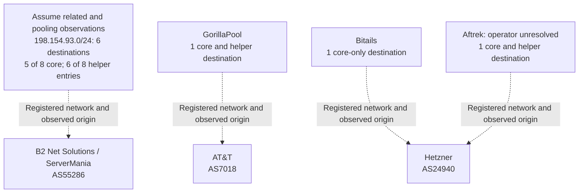
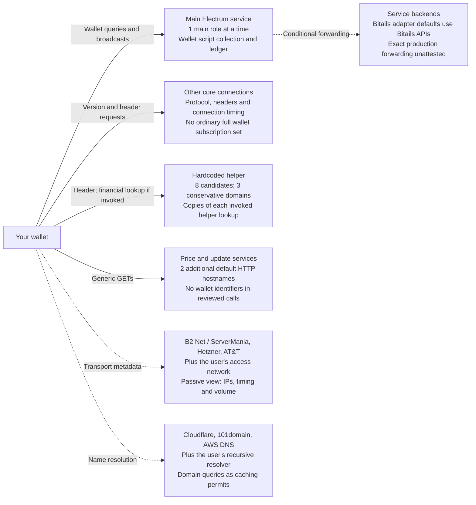

# How many parties does a default session trust?

Research date: October 28, 2026. Client: ElectrumSVP 0.2.0, pinned commit `672df8f4512f6adf16a3c99146baa6be9b93d86f`. Start with [the plain-language stories](PRIVACY-STORIES.md) for everyday examples. [The main report](REPORT.md) contains the financial experiments and underlying attribution sources.

**Consumer threat model: assume correlation and sharing.** For this report, a privacy-conscious consumer should treat all six endpoints in **198.154.93.0/24** as related and able to combine everything they receive. The consumer cannot verify their separation. Also evaluate the case where every service provider shares its observations: separation of brands does not provide an enforceable privacy boundary. These are deliberately conservative risk assumptions, requested for this assessment. Public registration proves the shared network relationship; common application administration and actual sharing remain unverified. An absence of contrary evidence is not proof of common ownership.

**Major centralization risk:** that single segment contains **6/9 (66.7%)** of the literal Electrum destinations, **5/8 (62.5%)** of the core entries, and **6/8 (75%)** of the helper entries. Changing between these six names does not reduce exposure under this threat model. Their concentration also creates a shared network-provider dependency. These are endpoint-entry proportions, not measured traffic shares, selection probabilities, physical co-location, or six independent replicas. Actual uptime and common administration are separate questions.

## Count the different relationships separately

| Measure | Count | What the count means |
| --- | ---: | --- |
| Core literal destination hosts | 8 | Startup inserts eight core server candidates. One main role handles wallet synchronization. |
| Core connection target | 10 | Ten worker slots are requested by default. This is neither ten distinct hosts nor ten independent operators; eight literal candidates can leave slots waiting. |
| Helper literal destination hosts | 8 | One invocation submits parallel work for eight candidates. Early success can cancel work that has not started; it cannot retract sent requests. |
| Core/helper overlap | 7 | Bitails is core-only; `sv3.satoshi.io` is helper-only. |
| Literal Electrum hostname union | **9** | `8 + 8 − 7`; neither 16 nor 18. |
| Conservative correlation domains: core / helper / union | **4 / 3 / 4** | Collapse the six shared-segment names into one domain. Other domains are GorillaPool, Bitails and the unresolved Aftrek endpoint. No independence between these domains is assumed. |
| Public attribution buckets before that collapse | 5 | Satoshi.io/ElectrumR association, GorillaPool, Bitails, unresolved Aftrek, unresolved `electrum.server.sv`. These are evidence labels, not five established legal operators. |
| Network resource/origin organizations in the nine-host snapshot | 3 | B2 Net Solutions / ServerMania, Hetzner, AT&T. A shared carrier is an additional correlation/availability concern, not evidence that the carrier ordinarily decrypts RPC traffic. |
| Authoritative DNS provider brands in those zones | 3 | Cloudflare, 101domain and AWS DNS. Recursive resolver, caching and delegation determine which queries reach them. |
| Additional default client HTTP service hostnames | 2 | `electrumsv.io` updates and `bananablocks.com` prices. The reviewed calls contain no wallet identifiers. |
| Reviewed literal client service hostname inventory | **11** | Nine Electrum names plus those two HTTP names. This is an inventory, not eleven actual recipients in every session or eleven legal parties. |
| Exact independent legal-party total | **Unknown** | Provider overlap, undisclosed administrators/subprocessors and downstream services prevent an honest exact total. |

**Do not add the application, network and DNS counts.** They describe different roles along overlapping paths. The user's access network and recursive DNS resolver add environment-specific dependencies; a VPN or Tor adds other roles if used. DNS caches may suppress authoritative queries. Saved/discovered peers, main-server changes, HTTPS redirects, user actions and server backends can extend the literal inventory. A single universal number of distinct companies is not established by this audit.

Under the widest sharing assumption, the remote services collectively form **one potential financial correlation domain**. A transaction lookup copied to helper services could then be joined to the richer script collection seen by the main service. Sharing does not create information no participant possessed: it does not reveal private labels, a legal identity or an unlimited HD key tree by itself.

The infrastructure map below uses dotted links for observed network relationships. Its six-host grouping is the consumer assumption; it does not assert that the other three domains are independent or that a carrier reads application plaintext.

## What one default-core session actually contacted

A new **unfunded** wallet ran with `server`, `oneserver`, `auto_connect`, `proxy` and the saved server cache all left unset. The unchanged upstream core selected `sv2.electrumr.sv` as main, used the default ten-worker target, enabled automatic connection selection and used no main proxy. The observation ran approximately **16:40:51–16:41:30 PDT** on October 28. Thirty-five seconds of observation followed network construction.

| Observed relationship | Result |
| --- | --- |
| Core connection attempts | All 8 literal core hosts |
| Core hosts completing observed RPCs | 7; `electrum.server.sv` had no successful observed core RPC |
| Startup helper TLS sends completing locally | 7 of 8 candidates; all carried `blockchain.block.header` with the same local-tip height |
| Unique Electrum hosts with a completed core RPC or helper send | **8**, representing **4 conservative correlation domains** and all **3 network-provider organizations** |
| Recipients completing the wallet's script subscriptions | **1**, `sv2.electrumr.sv`, with **40 distinct script hashes** |
| Financial helper requests in this unfunded run | **0**; the helper's observed request was a block height, not a TXID or script hash |
| GUI update/daemon price requests observed | **Not run by this headless core harness**; their default behavior is a source finding |

The eight observed hosts were `bsv.aftrek.org`, `electrumx.gorillapool.io`, `esv.bitails.io`, `sv.electrumr.sv`, `sv.satoshi.io`, `sv2.electrumr.sv`, `sv2.satoshi.io` and `sv3.satoshi.io`. The helper adds `sv3.satoshi.io` to the core's seven responding names; Bitails is absent from the helper list. This is observed fanout, not an assumption that every candidate answered.

Controls: headless application callbacks, isolated paths, a disposable account and client-side observation wrappers. No endpoint relay, server override, proxy override or one-server override was used. Successful client TLS writes are evidence that the send completed locally over an established TLS connection, **not access to the server's retention logs**. Core RPC completion shows a response; it does not prove truthful application behavior. No full desktop GUI capture, real funding or ownership deanonymization was attempted. Disposable wallet state was removed after shutdown.

The [raw event stream](evidence/default-session-attempt-01/events.jsonl), [run summary](evidence/default-session-attempt-01/run.json), [process log](evidence/default-session-attempt-01-process.log) and [independent event-accounting check](evidence/trust-model-20261028/observation-verification.json) are retained. This new observation complements the earlier server-side relay capture; it does not replace or relabel it.

## Who can see which data?

The diagram shows **roles**, which may belong to the same party. The main may also be a helper recipient. Solid arrows carry application content. Dotted arrows show metadata or conditional downstream exposure; they do not assert passive TLS decryption by an infrastructure provider.

**Correlation assumption:** pool the observations of the six shared-segment services. In the wider sharing scenario, pool M, H and any participating backends across brands. Infrastructure providers are not automatically credited with decrypted data. In this source/runtime the Electrum TLS paths do not authenticate certificates: an active adversary able to redirect or intercept those connections could impersonate a server and gain its visibility. That is a conditional capability, not a performed attack or proof an ISP does so.

| Role | Directly sees or can retain at its boundary | Financial reconstruction available | What is not supplied by the reviewed path |
| --- | --- | --- | --- |
| Current main service | Connecting IP or proxy exit; session/timing; active script hashes; history/TXID/proof requests and responses; raw signed broadcast | Associate the queried collection, resolve funded scripts from the ledger, reconstruct amounts/UTXOs and likely change, watch unresolved hashes later | Mnemonic, private keys, xpub, private labels, guaranteed legal identity or purpose of payment |
| Additional main services after switching | The collection sent while each becomes main | Each may retain its own copy; switching or closing does not revoke it | Automatic erasure of earlier copies |
| Other core peers | Peer connection/version/header traffic | Evidence the connecting IP uses the protocol; header requests alone do not identify the wallet ledger | The complete wallet collection solely because they are auxiliary peers |
| Startup helper recipients | Source IP or helper proxy exit, timing and queried block height | Wallet/app activity and local-header progress; a block height is not a specific financial transaction | Wallet balances, address collection or TXID from that header-only request |
| Financial helper recipients, when invoked | Requested TXID, TXID+height, or particular script hash; matching data returned by the service | Transaction contents and amounts reachable from that request; correlations with other lookups; a script query can expose that script's UTXOs | The entire wallet subscription collection solely from one TXID or one script lookup |
| Bitails adapter's default upstream | Source-derived paths contain script hashes; backend returns ledger data | The queried interests and corresponding ledger; it can participate in sharing | Direct visibility of the end-user IP is not established; normally the adapter is its connecting client, unless forwarding adds more |
| Price/update HTTP service | Connecting IP, generic request path, user-agent `ElectrumSV`, request timing | App-use metadata; no wallet balance follows from the reviewed generic GETs | Wallet script hashes, TXIDs, payment amounts or a serialized wallet balance |
| Access network / routing provider, acting passively | IP endpoints, timing, volume; names may be exposed by DNS/SNI depending on the path | Traffic association and possible correlation clues | Decrypted TLS RPC arguments merely from being a carrier |
| Recursive DNS / authoritative DNS | Requested names and resolver/client context as its role permits | Service-use metadata; authoritative servers often see the recursive resolver rather than the user's IP | Financial RPC arguments inside TLS |
| Infrastructure administrator with process, host or hypervisor access | Conditional access to a TLS terminator or runtime can expose application plaintext | Potentially the service's visibility if that access exists | Allocation/routing records alone do not establish such access or actual collection |

## Why the helper is part of the default trust model

[Startup header validation](https://github.com/TruthMachine/ElectrumSVP/blob/672df8f4512f6adf16a3c99146baa6be9b93d86f/electrumsv/headers_storage.py#L99-L134) invokes the helper automatically after local header-file validation. The new observation confirms public header fanout. The [parallel helper](https://github.com/TruthMachine/ElectrumSVP/blob/672df8f4512f6adf16a3c99146baa6be9b93d86f/electrumsv/verification_utils.py#L335-L500) uses a separate eight-host list and its own Tor-detection logic. Choosing one main server or configuring an arbitrary main-network proxy does not constrain it.

[Proof storage automatically attempts BEEF construction](https://github.com/TruthMachine/ElectrumSVP/blob/672df8f4512f6adf16a3c99146baa6be9b93d86f/electrumsv/wallet.py#L3043-L3060). Missing transaction bodies or proofs can then trigger financial helper lookups. Locally available data can prevent those requests. Additional explicit verification paths also use the helper. Therefore financial fanout is **conditional, sometimes automatic**, rather than present for every newly opened unfunded wallet. The earlier [exact-function eight-peer test](evidence/fanout-attempt-01/fanout.json) demonstrated eight copies of one TXID lookup under controlled delivery conditions; this new public run demonstrates header traffic, not eight public financial dossiers.

## Default HTTP services and scope limits

The [GUI update code](https://github.com/TruthMachine/ElectrumSVP/blob/672df8f4512f6adf16a3c99146baa6be9b93d86f/electrumsv/gui/qt/app.py#L370-L388) enables `check_updates=True`, requests `https://electrumsv.io/release.json`, and is called from `run_app`. The [online daemon](https://github.com/TruthMachine/ElectrumSVP/blob/672df8f4512f6adf16a3c99146baa6be9b93d86f/electrumsv/daemon.py#L153-L160) starts `FxTask`. Its defaults are `use_exchange_rate=True`, `use_exchange=BananaBlocks`, USD and enabled historical rates. [BananaBlocks' two paths](https://github.com/TruthMachine/ElectrumSVP/blob/672df8f4512f6adf16a3c99146baa6be9b93d86f/electrumsv/exchange_rate.py#L201-L229) are `/api/v1/exchangerates` and `/api/v1/stats/chart/exchange_rate?days=365`, on the same host. Historical prices are a generic series, not uploaded wallet history. Both HTTP implementations use Requests directly; they do not consult the core Network proxy in the reviewed calls.

This audit does not identify these two websites' current legal operators or downstream HTTP infrastructure. It adds two **service names**, not two verified independent companies. Custom OS proxy settings or HTTPS redirects may change actual paths. Extensions, explorer clicks, payment requests, hardware-wallet features and changed exchanges require their own accounting; they are not silently counted as default financial recipients. The reviewed extension flags default to disabled.

The researcher's Bitails/WhatsOnChain reference probes, GitHub source access and documentation sites are not wallet-session destinations just because the investigation used them. Bitails APIs are separately relevant as the adapter's source-derived backend path.

[Machine-readable counts and distributions](evidence/trust-model-20261028/model.json) are recomputable offline. [Pinned source receipts](evidence/trust-model-20261028/source-receipts.json) check the literal pools and relevant defaults against unchanged Git blobs. No source availability or deployment-attestation gap was resolved by counting endpoints.
