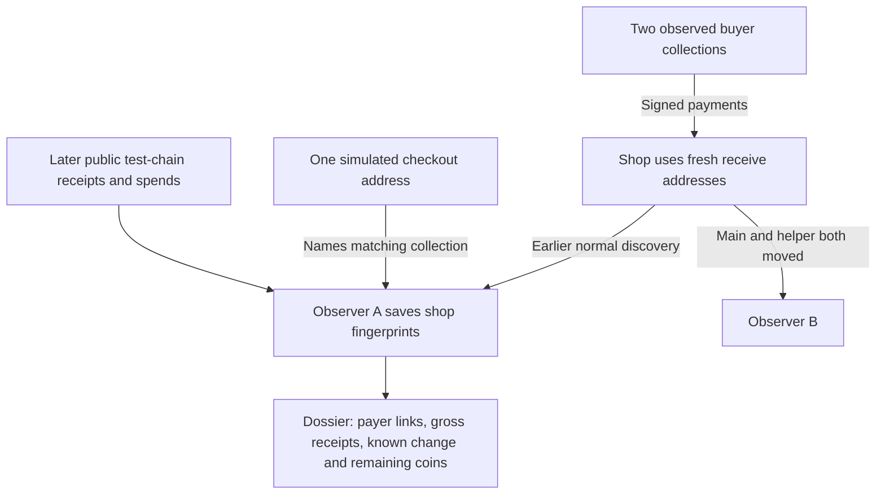

# Valid-chain shop and lasting-observation experiment

On October 29, 2026, three actual ElectrumSVP 0.2.0 wallet cores used a locally isolated Bitcoin SV 1.2.3 regtest chain. Mature mined coins funded two buyers. The wallets signed payments, the node accepted them, blocks confirmed them, and the wallets stored inclusion proofs. No mainnet/testnet money, production user or real merchant was involved.

The observer analyzer received **only observer A's retained protocol journal, public chain transactions and one simulated checkout address**. It received no wallet database, seed, xpub, derivation map or observer B journal. The one-address anchor identified the shop-associated query collection before payment. Three customers paid three different shop addresses; two payer collections were known to A and the third payer remained unidentified.

| Event | Satoshis | Operator inference |
| --- | ---: | --- |
| Buyer A pays first fresh shop address | 2,500,000 | Flow from observed buyer A collection |
| Buyer B pays another fresh shop address | 4,000,000 | Flow from observed buyer B collection |
| Unknown payer pays third fresh shop address | 1,250,000 | Receipt, payer identity unknown |
| Shop moves both main and helper to B | — | A receives no further client request |
| Later receipt to previously disclosed unused shop address | 1,700,000 | A matches it from retained identifiers and chain data |
| Shop signs payment through B | 1,100,000 plus 1,000 fee | A recognizes known input and 1,399,000 change to a disclosed script |
| Gross observed receipts / remaining observed coins | **9,450,000 / 8,349,000** | Agrees with the shop wallet's balance |

[Phase receipts and wallet proofs](evidence/valid-chain-attempt-05/phases.json), [operator reconstruction](evidence/valid-chain-attempt-05/result.json), [observer A](evidence/valid-chain-attempt-05/capture-A.jsonl), [observer B](evidence/valid-chain-attempt-05/capture-B.jsonl), [raw blocks](evidence/valid-chain-attempt-05/node-blocks.json), [raw transactions](evidence/valid-chain-attempt-05/node-transactions.json), [private-state cleanup](evidence/valid-chain-attempt-05/cleanup.json).

This is a **research Electrum adapter backed by a real consensus-validating node**, not ElectrumR or an attested public deployment. The adapter answers with actual node headers, transaction bodies and Merkle branches and submits broadcasts to the node. The release comments out its regtest network class and hardcodes mainnet in its header loader. The harness supplies regtest constants and a regtest header-loader adapter while leaving wallet accounting, signing, discovery and networking modules unedited. One-server mode, loopback endpoints, local helper routing and restricted candidate pools are experimental controls. The switch deliberately moves **both** routes; it is not evidence that changing the GUI main-server field alone controls the helper. The adapter handles this linear chain, not arbitrary reorgs.

The node ran in a Docker internal network on this Mac, with no peers, no published host RPC port, bounded CPU/memory and ignored credentials/data. Image: `bitcoinsv/bitcoin-sv:1.2.3`, pinned `sha256:d96fe4786a00e5fc10bc9e0e76a6006376f9472d4eb74d07e4c1e0d019493d33`. This is a vendor image pin, not a source-to-binary reproducible-build attestation. See [vendor Docker instructions](https://docs.bsvblockchain.org/network-topology/nodes/sv-node/installation/sv-node/docker).

A second node with an empty data directory accepted all **210 retained non-genesis blocks**, reached the identical tip and passed `verifychain 4 0` with zero peers. It rejected `bad-txnmrklroot` for a transaction mutation with an inconsistent root and `blk-bad-inputs` for an invalid signature after the harness recomputed the root and valid regtest proof of work. [Replay and negative controls](evidence/chain-clean-replay-attempt-03/result.json). This is independent state using the same node implementation, not an independent researcher or consensus implementation.

Attempts 01–04 remain retained: a harness account/wallet method error, an asynchronous synchronization wait error, a command-line-locked setting, and candidate-pool selection during migration. Their generated private wallet state was removed. The final pass does not reclassify those attempts. The initial node startup omitted a required mining-policy setting; that failure is also retained. Fresh-node replay attempts 01–02 exposed an entrypoint error and the CLI's empty representation of JSON null; final attempt 03 corrected those observer errors.

The collection remains finite. A match proves a queried interest and ledger relationship; a connection or IP does not prove legal ownership. Undisclosed destinations are not automatically attributed, mixed-input payments need separate reasoning, and gross receipts are not necessarily sales, revenue or profit.
